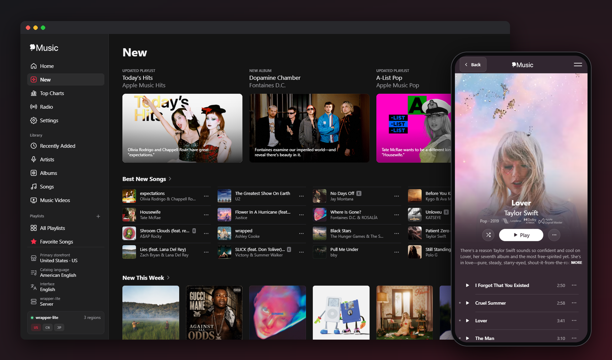

<div align="center">

# am-hook

**Apple Music in your browser: lossless, Dolby Atmos and music videos, decrypted with WebAssembly.**

[](https://github.com/itouakirai/am-hook/releases/latest)
[](https://github.com/itouakirai/am-hook/actions/workflows/build-test.yml)
[](LICENSE)
[](https://t.me/apple_music_alac)

[中文](README.zh-CN.md) | English



</div>

An Apple Music decryption tool written in Rust, covering songs (FairPlay HLS) and music videos (PlayReady HLS).

By default **decryption happens entirely in the browser**. The server only talks to wrapper-lite (master playlists, decryption templates, licenses). The browser fetches media straight from Apple's CDN and decrypts it with WebAssembly in Web Workers, so no media traffic goes through the server.

## Contents

- [Highlights](#highlights)
- [Screenshots](#screenshots)
- [Quick Start](#quick-start)
- [Deploying without the binary](#deploying-without-the-binary)
- [Documentation](#documentation)
- [Community](#community)
- [License](#license)

## Highlights

- **Every quality**: lossless ALAC (up to 24-bit / 192 kHz), Dolby Atmos, AAC, HE-AAC, binaural and downmix, plus music videos up to 4K Dolby Vision with Atmos audio.
- **Decrypted in the browser**: WebAssembly in Web Workers; media never passes through the server.
- **Plays anywhere**: built-in gapless player with a shared queue and AutoMix transitions planned from Apple Music's audio analysis, ALAC-to-FLAC and EC-3-to-PCM fallbacks, system media controls, and optional Dolby Atmos object rendering (JOC) to stereo speakers or binaural headphones right in the browser.
- **Feels like music.apple.com**: search, New, Top Charts, Radio, album / playlist / artist / editorial pages, and synced lyrics rendered by [AMLL](https://github.com/amll-dev/applemusic-like-lyrics).
- **Downloads done properly**: per-track or whole albums / playlists, iTunes tags, cover art and lyrics, ZIP / folder / file output with name templates.
- **ALAC check**: without requesting `/key`, finds the ALAC escape frames whose end was overwritten across a whole album, with the packaging date and the real bit depth and bandwidth of the first 15 seconds.
- **Your library, locally**: library, playlists, favorites and folders kept in the browser's IndexedDB, with import / export.
- **Deploy your way**: a single binary, or Vercel / Cloudflare Workers with one click.

## Screenshots

<table>
  <tr>
    <td width="33%"></td>
    <td width="33%"></td>
    <td width="33%"></td>
  </tr>
  <tr>
    <td align="center">Album</td>
    <td align="center">Artist</td>
    <td align="center">Top Charts</td>
  </tr>
</table>

## Quick Start

Download a prebuilt binary for Windows, Linux or macOS from [Releases](https://github.com/itouakirai/am-hook/releases/latest), or build it yourself:

```sh
cargo build --release

# The browser decrypts; the server only serves playlists, templates and licenses
am-hook --listen 0.0.0.0:8888 --wrapper-url http://127.0.0.1:12340
```

Then open `http://127.0.0.1:8888/` and paste a link or search.

### Requirements

- A running [wrapper-lite](https://github.com/WorldObservationLog/wrapper) key server (default `http://127.0.0.1:12340`)
- A modern browser with Web Workers and WebAssembly. Playback uses MediaSource (EC-3 PCM fallback uses Web Audio); MV downloads need OPFS.
- Rust 2021 edition toolchain, only when building from source

> [!NOTE]
> OPFS is only available in a secure context: HTTPS, or `localhost` / `127.0.0.1`. Over `http://<LAN IP>`, song downloads fall back to in-memory Blobs (large files use more RAM) and MV downloads are unavailable. Playback is unaffected.

### Opening Apple Music links

Pages can also be opened directly by putting an Apple Music link after the server address:

| Input on the home page | Page opened |
|---|---|
| `https://music.apple.com/cn/song/<slug>/<id>` | `/https://music.apple.com/cn/song/<slug>/<id>` |
| `https://music.apple.com/cn/album/<slug>/<albumId>?i=<id>` | `/https://music.apple.com/cn/album/<slug>/<albumId>?i=<id>` |
| `https://music.apple.com/cn/music-video/<slug>/<id>` | `/https://music.apple.com/cn/music-video/<slug>/<id>` |
| `https://music.apple.com/cn/post/<id>` | `/https://music.apple.com/cn/post/<id>` |
| `https://music.apple.com/cn/playlist/<slug>/<pl.id>` | `/https://music.apple.com/cn/playlist/<slug>/<pl.id>` |
| `https://music.apple.com/cn/artist/<slug>/<id>` | `/https://music.apple.com/cn/artist/<slug>/<id>` |

For example: `http://127.0.0.1:8888/https://music.apple.com/cn/music-video/super-bowl-lix-halftime-show-live/1836358807`. The country code in the link selects the storefront used for metadata. Station, editorial and chart links open too; see [Pages](docs/guide.md#pages).

## Deploying without the binary

The same pages also run on a serverless platform: the platform hosts the static files and the backend shrinks to a single function. The build needs only Node.

| Platform | One click | CLI |
|---|---|---|
| Vercel | [](https://vercel.com/new/clone?repository-url=https%3A%2F%2Fgithub.com%2Fitouakirai%2Fam-hook) | `npx vercel --prod` |
| Cloudflare Workers | [](https://deploy.workers.cloudflare.com/?url=https://github.com/itouakirai/am-hook) | `npx wrangler deploy` |

A function cannot reach a wrapper-lite on your machine, so pages use your local wrapper-lite directly, or the function relays to a public one set through environment variables. See [Deployment](docs/deployment.md) for both, and for how a serverless deployment differs from the binary.

## Documentation

| Document | Contents |
|---|---|
| [User Guide](docs/guide.md) | Navigation, player, pages, lyrics, music videos, radio, library, downloads and settings |
| [Deployment](docs/deployment.md) | Vercel / Cloudflare, environment variables, using a local wrapper-lite |
| [Reference](docs/reference.md) | Command-line options and server endpoints |
| [Architecture](docs/architecture.md) | How decryption and playback work, which file implements what, the source layout |
| [Development](docs/development.md) | Building the binary and the WASM modules, adding front-end files, running the tests |
| [Changelog](CHANGELOG.en.md) | Changes in every release |

## Community

Questions, feedback and discussion: the Telegram group [@apple_music_alac](https://t.me/apple_music_alac). Bug reports and feature requests are still welcome in [Issues](https://github.com/itouakirai/am-hook/issues).

## License

am-hook is licensed under the [GNU Affero General Public License v3.0 only](LICENSE) (AGPL-3.0-only), because the web UI embeds the AGPL-licensed [AMLL](https://github.com/amll-dev/applemusic-like-lyrics) lyric player. If you run a modified version as a network service, you must offer its users the corresponding source.

Bundled third-party components keep their own licenses: `crates/temari` (MIT), the hls.js CEA-608 parser (Apache-2.0, `vendor/cea608/LICENSE`), `@mediabunny/ac3` (MPL-2.0, `web/ec3/LICENSE.txt`), AMLL with its dependencies (AGPL-3.0-only, `vendor/amll`), the JOC renderer from am-hook-joc (AGPL-3.0-only or MIT, `crates/joc-core/LICENSE`), the lyric artwork background from YouLyPlus (MIT, notice in `web/lyrics/backdrop-render.mjs`) and the SADIE II HRTF fields (Apache-2.0, see `web/joc/NOTICE.md`).
