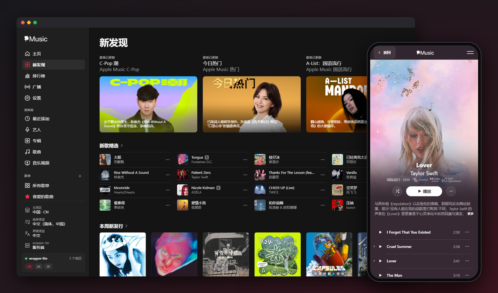

<div align="center">

# am-hook

**在浏览器里听 Apple Music：无损、杜比全景声与 MV，全部由 WebAssembly 在本地解密。**

[](https://github.com/itouakirai/am-hook/releases/latest)
[](https://github.com/itouakirai/am-hook/actions/workflows/build-test.yml)
[](LICENSE)
[](https://t.me/apple_music_alac)

中文 | [English](README.md)



</div>

一个用 Rust 编写的 Apple Music 解密工具，支持歌曲（FairPlay HLS）和 MV（PlayReady HLS）。

**解密完全在浏览器中完成**：服务端只与 wrapper-lite 通信（master 播放列表、解密模板、许可证），媒体数据由浏览器直接从 Apple CDN 获取，并在 Web Worker 中用 WebAssembly 解密，不消耗服务器流量。

## 目录

- [亮点](#亮点)
- [截图](#截图)
- [快速开始](#快速开始)
- [不用二进制部署](#不用二进制部署)
- [文档](#文档)
- [交流群](#交流群)
- [许可证](#许可证)

## 亮点

- **全部音质**：无损 ALAC（最高 24-bit / 192 kHz）、杜比全景声、AAC、HE-AAC、双耳与缩混版本，以及最高 4K 杜比视界、全景声音轨的 MV。
- **浏览器内解密**：Web Worker 中的 WebAssembly 完成解密，媒体数据不经过服务器。
- **到处都能播**：内置无缝衔接的播放器与播放队列，按 Apple Music 音频分析规划的 AutoMix 过渡，ALAC 转 FLAC、EC-3 转 PCM 兜底，支持系统媒体控制；还可以在浏览器内把杜比全景声对象（JOC）渲染为立体声扬声器或双耳耳机输出。
- **与 music.apple.com 一样的体验**：搜索、新发现、排行榜、广播，专辑 / 歌单 / 艺人 / 编辑页，以及由 [AMLL](https://github.com/amll-dev/applemusic-like-lyrics) 渲染的逐字歌词。
- **完整的下载**：单曲或整张专辑 / 歌单，写入 iTunes 标签、封面与歌词，可保存为 ZIP / 文件夹 / 逐个文件，支持文件名模板。
- **ALAC 检测**：不请求 `/key`，找出整张专辑中末尾被覆盖的 ALAC 原样帧，并给出打包日期与前 15 秒的实际位深、频宽。
- **本地资料库**：资料库、歌单、喜爱与文件夹保存在浏览器的 IndexedDB 中，可导入 / 导出。
- **部署方式随意**：单个二进制，或一键部署到 Vercel / Cloudflare Workers。

## 截图

<table>
  <tr>
    <td width="33%"></td>
    <td width="33%"></td>
    <td width="33%"></td>
  </tr>
  <tr>
    <td align="center">专辑</td>
    <td align="center">艺人</td>
    <td align="center">排行榜</td>
  </tr>
</table>

## 快速开始

从 [Releases](https://github.com/itouakirai/am-hook/releases/latest) 下载 Windows / Linux / macOS 的预编译二进制，或自行构建：

```sh
cargo build --release

# 浏览器端解密，服务端只提供播放列表、解密模板与许可证
am-hook --listen 0.0.0.0:8888 --wrapper-url http://127.0.0.1:12340
```

浏览器打开 `http://127.0.0.1:8888/`，粘贴链接或搜索即可。

### 环境要求

- 运行中的 [wrapper-lite](https://github.com/WorldObservationLog/wrapper) 密钥服务（默认 `http://127.0.0.1:12340`）
- 支持 Web Worker 和 WebAssembly 的现代浏览器。播放使用 MediaSource（EC-3 PCM 回退使用 Web Audio）；MV 下载需要 OPFS。
- Rust 2021 edition 工具链（仅从源码构建时需要）

> [!NOTE]
> OPFS 只在安全上下文中可用，也就是 HTTPS 或 `localhost` / `127.0.0.1`。通过 `http://<局域网 IP>` 访问时，歌曲下载退回内存 Blob（大文件占用较多内存），MV 无法下载；播放不受影响。

### 打开 Apple Music 链接

也可以把 Apple Music 链接直接拼在服务地址后面打开对应页面：

| 首页输入 | 打开的页面 |
|---|---|
| `https://music.apple.com/cn/song/<slug>/<id>` | `/https://music.apple.com/cn/song/<slug>/<id>` |
| `https://music.apple.com/cn/album/<slug>/<albumId>?i=<id>` | `/https://music.apple.com/cn/album/<slug>/<albumId>?i=<id>` |
| `https://music.apple.com/cn/music-video/<slug>/<id>` | `/https://music.apple.com/cn/music-video/<slug>/<id>` |
| `https://music.apple.com/cn/post/<id>` | `/https://music.apple.com/cn/post/<id>` |
| `https://music.apple.com/cn/playlist/<slug>/<pl.id>` | `/https://music.apple.com/cn/playlist/<slug>/<pl.id>` |
| `https://music.apple.com/cn/artist/<slug>/<id>` | `/https://music.apple.com/cn/artist/<slug>/<id>` |

例如：`http://127.0.0.1:8888/https://music.apple.com/cn/music-video/super-bowl-lix-halftime-show-live/1836358807`。链接中的国家代码决定获取展示信息时使用的地区。电台、编辑页与排行榜的链接同样可以打开，见[页面一览](docs/guide.zh-CN.md#页面一览)。

## 不用二进制部署

同样的页面也可以部署到 serverless 平台：平台托管静态文件，后端缩减为一个函数。构建只需要 Node。

| 平台 | 一键部署 | 命令行 |
|---|---|---|
| Vercel | [](https://vercel.com/new/clone?repository-url=https%3A%2F%2Fgithub.com%2Fitouakirai%2Fam-hook) | `npx vercel --prod` |
| Cloudflare Workers | [](https://deploy.workers.cloudflare.com/?url=https://github.com/itouakirai/am-hook) | `npx wrangler deploy` |

平台上的函数访问不到你本机的 wrapper-lite，因此页面直接使用你的本地 wrapper-lite，或者由函数转发到通过环境变量设置的公网 wrapper-lite。两种方式以及 serverless 部署与二进制的区别见[部署](docs/deployment.zh-CN.md)。

## 文档

| 文档 | 内容 |
|---|---|
| [使用指南](docs/guide.zh-CN.md) | 导航、播放器、各页面、歌词、MV、广播、资料库、下载与设置 |
| [部署](docs/deployment.zh-CN.md) | Vercel / Cloudflare、环境变量、使用本地 wrapper-lite |
| [参考](docs/reference.zh-CN.md) | 命令行参数与服务端接口 |
| [架构](docs/architecture.zh-CN.md) | 解密与播放的原理、每个功能由哪些文件实现、目录结构 |
| [开发](docs/development.zh-CN.md) | 构建二进制与 WASM、新增前端文件、运行测试 |
| [更新日志](CHANGELOG.md) | 每个版本的变化 |

## 交流群

使用问题、反馈与讨论：Telegram 群组 [@apple_music_alac](https://t.me/apple_music_alac)。Bug 与功能建议仍欢迎提交到 [Issues](https://github.com/itouakirai/am-hook/issues)。

## 许可证

am-hook 以 [GNU Affero 通用公共许可证 v3.0（仅此版本）](LICENSE)（AGPL-3.0-only）发布，因为 Web 界面内嵌了以 AGPL 授权的 [AMLL](https://github.com/amll-dev/applemusic-like-lyrics) 歌词播放器。如果将修改后的版本作为网络服务运行，需要向其用户提供对应的源代码。

内置的第三方组件保留各自的许可证：`crates/temari`（MIT）、hls.js CEA-608 解析器（Apache-2.0，`vendor/cea608/LICENSE`）、`@mediabunny/ac3`（MPL-2.0，`web/ec3/LICENSE.txt`）、AMLL 及其依赖（AGPL-3.0-only，`vendor/amll`）、来自 am-hook-joc 的 JOC 渲染器（AGPL-3.0-only 或 MIT，`crates/joc-core/LICENSE`）、来自 YouLyPlus 的歌词封面背景（MIT，声明见 `web/lyrics/backdrop-render.mjs`），以及 SADIE II HRTF 场（Apache-2.0，见 `web/joc/NOTICE.md`）。
