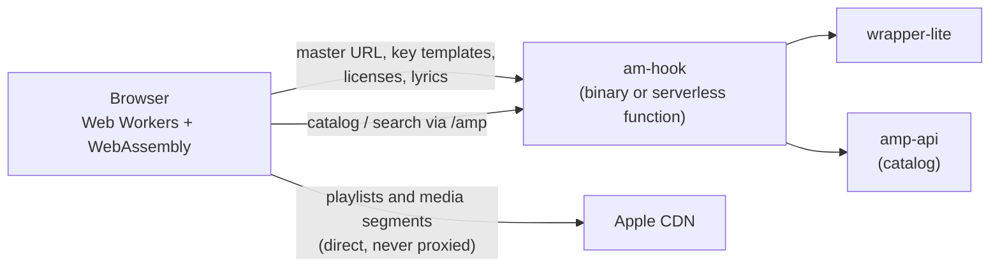

# Architecture

[中文](architecture.zh-CN.md) | English

- [How it works](#how-it-works): what runs where, and the flows for songs, AAC-LC songs, music videos and stations
- [Feature map](#feature-map): which files implement each feature
- [Source layout](#source-layout): every directory and module

## How it works

am-hook is a small Rust server (or one serverless function) plus a large browser app. The server never touches media: it relays wrapper-lite (master playlist URLs, decryption templates, licenses, lyrics) and proxies the amp-api catalog. The browser fetches playlists and segments straight from Apple's CDN and decrypts them with WebAssembly in Web Workers.



### Songs: browser-side decryption

In the browser (`web/decrypt/decrypt.js`):

1. With the master m3u8 URL from wrapper-lite, the browser fetches the master directly from the Apple CDN and parses its variants (`web/wrapper.js`).
2. The media m3u8 is fetched directly from `aod.itunes.apple.com` (the CDN allows CORS and Range requests) and parsed into the init segment, fragment byte ranges and the key used by each fragment.
3. Fragments under the prefetch key (`skd://itunes.apple.com/P000000000/s1/e1`, usually only the first one, sometimes more) use the template embedded in the wasm; once the playlist switches to the track key, the rest use the track template from `/key`.
4. Fragments are fetched with Range requests and decrypted in place by a Worker pool (one `hook.wasm` instance per Worker). The decryption code lives in `crates/am-mp4`.
5. **Playback**: decrypted fragments feed MSE when the original codec is supported. If ALAC is unavailable but FLAC-in-MP4 is, the on-demand `flac.wasm` losslessly converts ALAC packets to FLAC frames and remuxes them into small fMP4 fragments. EC-3 uses MSE when supported, otherwise the on-demand `ec3.wasm` decoder plays 5.1/7.1 PCM through Web Audio (no Atmos object rendering). With JOC object rendering on, `joc/decode-worker.js` decodes the core with `ec3.wasm` and renders the objects with `joc.wasm` (`crates/joc-core`); with AudioWorklet available, fragments are only split into queued syncframes that are rendered frame by frame along the playback position reported by `joc/output-worklet.js` (only ~0.1 s ahead, so the spatial scene's head turns and walking are heard at once), and the audio goes from the Worker straight to the AudioWorklet over a MessagePort; otherwise each ~15 s fragment is rendered in batches that are scheduled as they arrive. A seek restarts the renderer 64 syncframes before the target (earlier frames of the fragment are skipped without decoding). Seeking jumps to the matching source fragment.
6. **Download**: 4 lanes fetch and decrypt concurrently and write each result at its original offset into an OPFS temporary file, which is then converted to a progressive MP4 like the reference downloader's `DefragmentMP4` (`M4A ` ftyp, `moov` before the media data) and handed to the browser to save. Without OPFS it falls back to in-memory Blobs.

`hook.wasm` repairs identifiable ALAC end-tag damage after decryption (for example, song `1691044818`). The init segment's track and sample description identify complete uncompressed mono/stereo packets; a missing or damaged 3-bit `TYPE_END` is restored to `111` so decoders no longer drop the frame. The last 4 bytes of such packets were already overwritten when Apple packaged them ([AppleMusicDecrypt#136](https://github.com/WorldObservationLog/AppleMusicDecrypt/issues/136)): the original last sample is not in the file, and the repair cannot restore it. Sample lengths and Range offsets stay unchanged. Settings can turn the repair off: the overwritten samples are lost either way, and turning it off only keeps saved files byte-for-byte as Apple serves them (FFmpeg and others then drop the frames without an END tag). "Check ALAC" lists the affected frames. Compressed packets, truncated PCM and packets without room for the tag are left untouched; FLAC transcoding keeps its fallback that can append a missing tag byte.

Box handling: FairPlay metadata boxes (`sinf`, `senc`, `saiz`, `saio`, `pssh`, and `sgpd`/`sbgp` with grouping type `seig`/`seam`) are replaced with equal-length `free` boxes, so byte lengths and Range offsets stay exact. The `enca` box in the init segment is rewritten to the original codec (`ec-3`, `mp4a`, `alac`, etc.).

### Songs without a master m3u8 (AAC-LC only, Widevine)

Some songs (for example `1569279827`) have no master m3u8: wrapper-lite `/m3u8` returns a whole `.m4p` file. As in the reference downloader (`internal/widevine-rip`), they are played and downloaded from the 256 kbps AAC-LC stream used for web playback:

1. `songMaster` (`web/wrapper.js`) sees that the URL is not an `.m3u8` (it is not fetched) and asks `/webplayback` (`/mv/webplayback/<adamId>` in server mode) for the media m3u8, offered as the only variant (`AAC · 256 kbps`, tagged "AAC-LC only"). A failed `/m3u8` request (HTTP 500, unreachable, …) is reported as an error and retried by batch downloads, never downgraded. Download settings are ignored for these songs, as in the reference; the file is marked as a fallback when another quality was preferred.
2. Its `EXT-X-KEY` is a `data:` URI with the key ID and the fragments are CENC (AES-CTR). The media Worker builds a Widevine license request (`crates/am-media/src/widevine.rs`, a port of the reference CDM with its built-in device; same `media_challenge` / `media_license` entry points as the MV PlayReady path) and sends it to wrapper-lite `/license` without `drm-type`. If Widevine fails, a PlayReady request for the same key ID is tried.
3. Fragments are decrypted with the content key in place by the same Worker pool (`hook_decrypt_cenc`, `cenc::decrypt_fragment_in_place`), keeping byte lengths, so playback, seeking and downloads work exactly as above.

### Music video decryption

- `/parse/mv/<adamId>` gets the master URL from wrapper-lite `/webplayback`, fetches it with `User-Agent: AM`, and returns the playlist text and final CDN URL. Browsers cannot change their User-Agent, and other User-Agents may get a master without 4K, so with a local wrapper-lite the master is still fetched by the server (`/parse/mv-master`).
- `/mv/webplayback/<adamId>` and `/mv/license` relay to wrapper-lite `/webplayback` and `/license` (MVs use PlayReady only; license errors are shown without falling back to another DRM). AAC-LC songs use the same two endpoints with Widevine requests (no `drm-type`).
- Track playlists and media segments are fetched by the browser directly from Apple.
- Challenge building, license parsing, CENC/CBCS decryption, caption repair, fragmented MP4 muxing and conversion to a progressive MP4 run in a Worker with `media.wasm` (Rust, see [crates/am-media](../crates/am-media/README.md)).
- Live playlists, discontinuities and changing initialization segments are not supported.

### Station streams

- Station resources come through `/amp` as usual. Account requests go from the server to `amp-api.music.apple.com` (not edge, never cached) with the developer token and the media-user-token from the page: `/station/next-tracks/<id>`, `/station/assets` (`/v1/play/assets?<playParams>&keyFormat=web`, giving the HLS URL and license server), `/station/catalog/...`, `/station/recent` and `/station/storefront`.
- The browser fetches the HLS of live radio and episodes directly (`itsliveradio.apple.com` allows cross-origin requests); the fMP4 segments list FairPlay, PlayReady and Widevine `EXT-X-KEY`s. The media Worker shared with music videos and AAC-LC songs builds a Widevine license request (PlayReady if Widevine fails), shaped by the license server as MusicKit does (for example `{ adamId, challenge, uri, key-system, … }` for `linear.tv.apple.com/v1/radio/streaming-key-delivery`), and `/station/license` sends it to Apple with both tokens (plus `X-Apple-Renewal` for Widevine): wrapper-lite's `/license` does not support stations. With the content key the Worker decrypts the segments for MediaSource.
- Live playlists have no `#EXT-X-ENDLIST`: playback starts 3 segments before the end of the window, the playlist is refreshed every `TARGETDURATION` and segments are appended by sequence number, jumping to the newest ones after falling out of the window. Downloads are for episodes only and work like MV downloads: segments go to OPFS and are rewritten as a progressive MP4 (an audio-only stream keeps its own track).

## Feature map

Paths under `web/` are served at `/assets/<same path>`, so a URL in the browser's network panel or a stack trace (`/assets/h/<path>.<hash>.js` for the content-hashed copy) points straight at its file.

| Feature | Browser (`web/`) | Server and crates |
|---|---|---|
| Song playback and FairPlay decryption | `decrypt/` (playlists, Worker pool, templates), `player/player.js` (engines and queue), `wrapper.js` (master parsing) | `src/handlers.rs` (`/parse/song`, `/key`), `crates/am-mp4`, `crates/am-wasm`, `crates/temari` |
| AAC-LC songs without a master (Widevine) | `wrapper.js` (`songMaster`), `media/` | `src/handlers.rs` (`/mv/webplayback`, `/mv/license`), `crates/am-media` (`widevine.rs`) |
| ALAC end-tag repair and ALAC check | `alac-check.mjs`, `views/alac-check-dialog.mjs`, `flac/` | `crates/am-alac`, `crates/am-flac-wasm` (`analysis.rs`) |
| ALAC-to-FLAC and EC-3 PCM fallbacks | `flac/`, `ec3/`, engines in `player/player.js` | `crates/am-flac-wasm` |
| Dolby Atmos object rendering (JOC) | `joc/` (worker, worklet, scene, HRTF), `JocEngine` / `JocLiveEngine` in `player/player.js` | `crates/joc-core`, `crates/joc-wasm` |
| AutoMix and crossfades | `player/automix.js` (planning), `Mixer` / `Voice` in `player/player.js` | — |
| Music videos | `mv/` (playlists, engine, captions), `views/mv.mjs`, `media/` | `src/handlers.rs` (`/parse/mv*`, `/mv/*`), `crates/am-media` (PlayReady, CENC/CBCS, mux, defrag, captions) |
| Radio and stations | `station.mjs` (token, licenses), `mv/radio.mjs` (HLS), `views/station.mjs`, `views/browse.mjs` (Radio page) | `src/amp.rs` (`station_*`), `serverless/core.mjs` |
| Catalog pages and search | `views/*.mjs`, `views/actions.mjs` (cover buttons, More menus), `i18n.js` (storefront, language) | `src/amp.rs` (token, HTTP/2, cache), `serverless/core.mjs` |
| Lyrics | `lyrics/` (`panel.mjs` wires the view to the player; `ttml.mjs`, `fonts.mjs`, `backdrop*.mjs`, `pulse.mjs`) | `src/handlers.rs` (`/lyrics`) |
| Downloads | `download/` (manager, center, tags, ZIP, names), `views/download-dialog.mjs`, `media/` (defrag) | — |
| Library and playlists | `library.mjs` (IndexedDB), `views/library*.mjs` | — (browser only) |
| Settings | `prefs.mjs` (store), `views/settings*.mjs` (page), `pickers.mjs` (nav pickers) | — |
| wrapper-lite modes and limits | `wrapper.js`, `pickers.mjs`, `host.js` | `src/wrapper.rs`, `src/limit.rs`, `src/handlers.rs` (`require_relay`) |
| Serverless deployment | the same `web/` | `serverless/core.mjs`, `serverless/cloudflare.mjs`, `api/handler.mjs`, `scripts/build-static.mjs`, `vercel.json`, `wrangler.toml` |

## Source layout

```
src/                   Rust server (the binary)
  main.rs              Startup: logging, banner, background tasks (amp-api warm-up, wrapper-lite check, update check)
  cli.rs               Command-line options
  lib.rs               Router: asset routes, wrapper-lite relays behind the limits, amp-api and station endpoints, page fallback
  state.rs             Configuration and shared clients (AppState)
  assets.rs            Embedded front end: the asset table (web/<path> = /assets/<path>), content-hashed URLs, ETags
  handlers.rs          Page shell and fallback for Apple Music page paths, host.js, wrapper-lite relays
                       (status, song master, key, lyrics, MV master / webplayback / license)
  wrapper.rs           wrapper-lite client: rate and concurrency limits, Authorization, queue stats
  limit.rs             Per-client-IP rate and concurrency limits for relayed wrapper-lite requests
  amp.rs               amp-api catalog / editorial / storefront proxy (developer token, HTTP/2 keep-alive, cache)
                       and station endpoints (media-user-token, license relay)
  links.rs             Apple Music link parsing and page-path matching (shared regex fragments; log.rs reuses them)
  log.rs               Startup summary and the one-line request log
  updater.rs           --check-update / --auto-update (GitHub Releases)
web/                   Browser app: embedded into the binary, served at /assets/ (app.html is the shell for every page URL)
  app.html / app.mjs / app.css
                       Shell: persistent player bar and lyrics view; the client-side router swaps page views
  pickers.mjs          Storefront, catalog language and wrapper-lite pickers at the bottom of the navigation
  i18n.js              Chinese / English strings; storefront and catalog language settings (AmI18n)
  prefs.mjs            Settings store (playback, downloads, lyrics, JOC, ...; localStorage); the page is views/settings.mjs
  host.js              Deployment flags; generated by the binary / function, this file is the fallback
  wrapper.js           wrapper-lite client: server relay or direct local wrapper-lite, master parsing, 429 back-off (AmWrapper)
  library.mjs          Library and playlist store (IndexedDB, cross-tab sync, import / export format and validation)
  station.mjs          Station endpoints needing a media-user-token; license request formats
  motion-art.mjs       Motion artwork on album, playlist and artist pages (editorialVideo HLS via MSE)
  alac-check.mjs       ALAC check: damaged escape-frame ends, packaging date, real bit depth and bandwidth
  player/              player.js: playback engines (MSE, FLAC, EC-3 PCM, JOC), mixer, queue and player bar (AmPlayer);
                       automix.js: AutoMix transition planning
  decrypt/             Song decryption: decrypt.js (m3u8 parsing, Worker pool, templates, download, OPFS), hook-worker.js, hook.wasm
  media/               media-worker.js + media.wasm: PlayReady / Widevine, CENC/CBCS, muxing and defrag
                       (MVs, stations, AAC-LC songs, song downloads)
  flac/                ALAC-to-FLAC transcoding worker, flac.wasm, the FLAC init segment
  ec3/                 EC-3 PCM fallback: decode worker, runtime and ec3.wasm (@mediabunny/ac3, see SOURCE.md)
  joc/                 Dolby Atmos objects (JOC): decode worker, joc.wasm, AudioWorklet output, spatial scene, hrtf/ (SADIE II)
  mv/                  MV playlists and track choice (hls.mjs), playback and download (engine.mjs), CEA-608 captions,
                       station HLS (radio.mjs), styles
  download/            Batch downloads: manager (downloads.mjs), download center (center.mjs), iTunes tags, ZIP, file names
  lyrics/              Lyrics view: panel.mjs (wiring to the player), TTML parsing, LRC export, the AMLL bundle,
                       artwork backdrop, beat pulse, font library and catalog
  views/               Page views: <name>.html + <name>.mjs (+ <name>.css), mounted by app.mjs; shared parts: actions.mjs
                       (cover buttons, More menus), detail-header.mjs, library-ui.mjs, download-dialog.mjs, alac-check-dialog.mjs
crates/
  am-mp4/              ISOBMFF parsing, box patching, sample decryption; embeds the prefetch-key template
  am-alac/             Conservative ALAC end-tag repair
  am-wasm/             Browser C ABI of am-mp4 (-> web/decrypt/hook.wasm)
  am-flac-wasm/        ALAC decoder and FLAC frame writer; PCM analysis for the ALAC check (-> web/flac/flac.wasm)
  am-media/            Browser media core: PlayReady, Widevine, CENC/CBCS, caption repair, MP4 muxing and defrag
  am-media-wasm/       Browser C ABI of am-media (-> web/media/media.wasm)
  temari/              Vendored Temari FairPlay decryption
  joc-core/            E-AC-3 JOC object reconstruction, Speaker 2.0 and binaural rendering (from am-hook-joc)
  joc-wasm/            Browser C ABI of joc-core (-> web/joc/joc.wasm)
serverless/            Serverless backend: core.mjs (counterpart of amp.rs and handlers.rs), cloudflare.mjs (Worker entry)
api/handler.mjs        Vercel Edge Function entry (the directory name is fixed by Vercel)
vendor/                Third-party sources of generated web files: amll (lyrics player bundle), cea608 (hls.js parser)
scripts/               build-wasm.sh, build-static.mjs (dist/ for serverless), build-amll.cjs, build-cea608.cjs, extract-ec3.mjs
tests/                 Rust integration tests (*.rs) and Node suites: unit/, ui/, live/, support/ (shared helpers), run.mjs
docs/                  This documentation and the README screenshots
```
