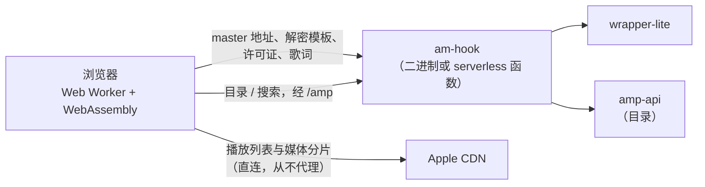

# 架构

中文 | [English](architecture.md)

- [工作原理](#工作原理)：各部分在哪里运行，以及歌曲、AAC-LC 歌曲、MV 与电台的流程
- [功能地图](#功能地图)：每个功能由哪些文件实现
- [目录结构](#目录结构)：每个目录与模块

## 工作原理

am-hook 由一个很小的 Rust 服务端（或一个 serverless 函数）和一个较大的浏览器应用组成。服务端从不经手媒体数据：它只转发 wrapper-lite（master 播放列表地址、解密模板、许可证、歌词）并代理 amp-api 曲库接口。浏览器直接从 Apple CDN 获取播放列表与分片，在 Web Worker 中用 WebAssembly 解密。



### 歌曲：浏览器端解密

浏览器端流程（`web/decrypt/decrypt.js`）：

1. 从 wrapper-lite 取得 master m3u8 地址后，浏览器直接从 Apple CDN 获取 master 并解析出各音质变体（`web/wrapper.js`）。
2. 直接从 `aod.itunes.apple.com` 获取 media m3u8（CDN 允许跨域和 Range 请求），解析出 init 段、各分片的字节范围，以及每个分片对应的 key。
3. 预取 key（`skd://itunes.apple.com/P000000000/s1/e1`）下的分片（通常只有第一个，也可能更多）使用内嵌在 wasm 中的模板，播放列表换成轨道 key 后，其余分片使用经 `/key` 获取的轨道模板。
4. 分片用 Range 请求拉取，交给 Worker 池（每个 Worker 一个 `hook.wasm` 实例）原地解密；解密逻辑位于 `crates/am-mp4`。
5. **播放**：浏览器支持原编码时，解密后的分片直接喂给 MSE。不支持 ALAC 但支持 FLAC-in-MP4 时，按需加载 `flac.wasm`，把 ALAC packet 无损转成 FLAC frame 并重新封装成较小的 fMP4 fragment。EC-3 在 MSE 支持时直接播放，否则按需加载 `ec3.wasm`，通过 Web Audio 播放 5.1/7.1 声道 PCM（不渲染 Atmos 对象）。开启 JOC 对象渲染时由 `joc/decode-worker.js` 用 `ec3.wasm` 解码核心声道、用 `joc.wasm`（`crates/joc-core`）渲染对象；有 AudioWorklet 时分片只拆成 syncframe 排队，按 `joc/output-worklet.js` 报回的播放进度逐帧渲染（只提前约 0.1 秒，空间声场的转头、走动等立刻听到），音频经 MessagePort 从 Worker 直接送到 AudioWorklet；否则每个约 15 秒的分片分批渲染、到一批排一批。Seek 时从目标前 64 个 syncframe 重新开始渲染（分片中更早的帧直接跳过，不解码）。拖动时直接定位到对应原始分片。
6. **下载**：4 路并发拉取和解密，结果按原始偏移写入 OPFS 临时文件，完成后像参考下载器的 `DefragmentMP4` 那样转为 progressive MP4（`M4A ` ftyp，`moov` 位于媒体数据之前），再交给浏览器保存。不支持 OPFS 时退回内存 Blob。

`hook.wasm` 会在解密后修复可确认的 ALAC 包尾错误（如歌曲 `1691044818`）：根据 init 中的轨道与 sample description，定位 PCM 完整的未压缩单声道／立体声包，将缺失或损坏的 3-bit `TYPE_END` 恢复为 `111`，解码器因此不再丢弃该帧；但这类包末尾 4 字节在 Apple 打包时已被覆盖（[AppleMusicDecrypt#136](https://github.com/WorldObservationLog/AppleMusicDecrypt/issues/136)），最后一个样本的原始数据不在文件中，修复无法还原它。修复不改变 sample 长度或 Range 偏移。也可在设置中心关闭修复：被覆盖的样本无论如何都已丢失，关闭只是让保存的文件与 Apple 提供的逐字节相同（缺 END 标记的帧会被 FFmpeg 等丢弃）。「检测 ALAC」可以列出受影响的帧。压缩包、PCM 截断及没有足够尾部空间的包不做原地修复；转 FLAC 时仍保留可追加结束标记的兜底。

box 处理：FairPlay 元数据 box（`sinf`、`senc`、`saiz`、`saio`、`pssh`，以及分组类型为 `seig`/`seam` 的 `sgpd`、`sbgp`）替换为等长的 `free` box，字节长度和 Range 偏移保持不变。init 段中的 `enca` box 改写为原始编码（`ec-3`、`mp4a`、`alac` 等）。

### 没有 master m3u8 的歌曲（只有 AAC-LC，Widevine）

有些歌曲（例如 `1569279827`）没有 master m3u8：wrapper-lite `/m3u8` 返回整首的 `.m4p` 文件。与参考实现（`internal/widevine-rip`）相同，这类歌曲改用网页播放的 256 kbps AAC-LC 播放和下载：

1. `songMaster`（`web/wrapper.js`）发现地址不是 `.m3u8`（不会去下载它），改向 `/webplayback`（服务端模式为 `/mv/webplayback/<adamId>`）取得 media m3u8，作为唯一的变体（`AAC · 256 kbps`，标注「仅 AAC-LC」）。`/m3u8` 请求失败（HTTP 500、连不上等）不会降级，而是报错，由批量下载自动重试。与参考实现一样，下载时不论音质设置都下载它；首选其他音质时标记为已降级。
2. 它的 `EXT-X-KEY` 是带 KID 的 `data:` URI，分片为 CENC（AES-CTR）。媒体 Worker 生成 Widevine license 请求（`crates/am-media/src/widevine.rs`，移植自参考实现的 CDM 与内置设备；与 MV 的 PlayReady 共用 `media_challenge` / `media_license`），不带 `drm-type` 发给 wrapper-lite `/license`。Widevine 失败时再用同一 KID 试 PlayReady。
3. 分片由同一个 Worker 池用内容密钥原地解密（`hook_decrypt_cenc`、`cenc::decrypt_fragment_in_place`），字节长度不变，因此播放、跳转与下载都与上面相同。

### MV 解密

- `/parse/mv/<adamId>` 从 wrapper-lite `/webplayback` 获取 master 地址，再以 `User-Agent: AM` 获取内容，返回播放列表文本和最终 CDN 地址。浏览器的 User-Agent 无法修改，用其他 User-Agent 获取可能拿不到 4K，所以使用本地 wrapper-lite 时 master 也交给服务端（`/parse/mv-master`）获取。
- `/mv/webplayback/<adamId>` 和 `/mv/license` 分别转发到 wrapper-lite `/webplayback` 和 `/license`（MV 只使用 PlayReady；许可证失败会显示错误，不切换其他 DRM）。只有 AAC-LC 的歌曲也经这两个接口，发送 Widevine 请求（不带 `drm-type`）。
- 音视频轨道 m3u8 和分片均由浏览器直连 Apple 获取。
- challenge 构建、license 解析、CENC/CBCS 解密、字幕修复、fragmented MP4 合并以及转为 progressive MP4 在 Worker 中由 `media.wasm` 完成（Rust 实现，见 [crates/am-media](../crates/am-media/README.md)）。
- 暂不支持直播、discontinuity 或中途更换初始化段的清单。

### 电台流

- 电台资源照常经 `/amp` 获取。需要账号的请求由服务端带上 developer token 与页面传来的 media-user-token 发往 `amp-api.music.apple.com`（不走 edge、不缓存）：`/station/next-tracks/<id>`、`/station/assets`（`/v1/play/assets?<playParams>&keyFormat=web`，返回 HLS 地址与 license 服务器）、`/station/catalog/...`、`/station/recent`、`/station/storefront`。
- 直播电台与广播单集的 HLS（`itsliveradio.apple.com`，允许跨源）由浏览器直接获取，fMP4 分片同时列出 FairPlay、PlayReady 与 Widevine 的 `EXT-X-KEY`。与 MV、AAC-LC 歌曲共用媒体 Worker：先用 Widevine（失败再用 PlayReady）生成 license 请求，按 license 服务器地址选择 MusicKit 的请求格式（如 `linear.tv.apple.com/v1/radio/streaming-key-delivery` 为 `{ adamId, challenge, uri, key-system, … }`），由 `/station/license` 带上两个 token（Widevine 另带 `X-Apple-Renewal`）发给 Apple——wrapper-lite 的 `/license` 不支持电台。取得内容密钥后在 Worker 中解密，交给 MediaSource 播放。
- 直播没有 `#EXT-X-ENDLIST`：从窗口末尾往前 3 个分片开始，按 `TARGETDURATION` 刷新列表并按序号追加，落到窗口之外时跳到最新的位置。下载只用于点播，与 MV 相同：分片写入 OPFS 后整理为标准 MP4（只有音频时保留原来的轨道）。

## 功能地图

`web/` 下的路径就是 `/assets/` 下的地址，所以浏览器网络面板或报错堆栈里的地址（内容哈希副本为 `/assets/h/<路径>.<hash>.js`）可以直接对应到文件。

| 功能 | 浏览器（`web/`） | 服务端与 crate |
|---|---|---|
| 歌曲播放与 FairPlay 解密 | `decrypt/`（播放列表、Worker 池、模板）、`player/player.js`（播放引擎与队列）、`wrapper.js`（解析 master） | `src/handlers.rs`（`/parse/song`、`/key`）、`crates/am-mp4`、`crates/am-wasm`、`crates/temari` |
| 没有 master 的 AAC-LC 歌曲（Widevine） | `wrapper.js`（`songMaster`）、`media/` | `src/handlers.rs`（`/mv/webplayback`、`/mv/license`）、`crates/am-media`（`widevine.rs`） |
| ALAC 包尾修复与 ALAC 检测 | `alac-check.mjs`、`views/alac-check-dialog.mjs`、`flac/` | `crates/am-alac`、`crates/am-flac-wasm`（`analysis.rs`） |
| ALAC 转 FLAC 与 EC-3 PCM 回退 | `flac/`、`ec3/`、`player/player.js` 中的引擎 | `crates/am-flac-wasm` |
| 全景声对象渲染（JOC） | `joc/`（Worker、AudioWorklet、声场界面、HRTF）、`player/player.js` 的 `JocEngine` / `JocLiveEngine` | `crates/joc-core`、`crates/joc-wasm` |
| AutoMix 与交叉淡化 | `player/automix.js`（规划）、`player/player.js` 的 `Mixer` / `Voice` | — |
| MV | `mv/`（播放列表、引擎、字幕）、`views/mv.mjs`、`media/` | `src/handlers.rs`（`/parse/mv*`、`/mv/*`）、`crates/am-media`（PlayReady、CENC/CBCS、合并、defrag、字幕） |
| 广播与电台 | `station.mjs`（token、许可证）、`mv/radio.mjs`（HLS）、`views/station.mjs`、`views/browse.mjs`（广播页） | `src/amp.rs`（`station_*`）、`serverless/core.mjs` |
| 曲库页面与搜索 | `views/*.mjs`、`views/actions.mjs`（封面按钮、「更多」菜单）、`i18n.js`（地区、语言） | `src/amp.rs`（token、HTTP/2、缓存）、`serverless/core.mjs` |
| 歌词 | `lyrics/`（`panel.mjs` 接入播放器；`ttml.mjs`、`fonts.mjs`、`backdrop*.mjs`、`pulse.mjs`） | `src/handlers.rs`（`/lyrics`） |
| 下载 | `download/`（管理器、下载中心、标签、ZIP、文件名）、`views/download-dialog.mjs`、`media/`（defrag） | — |
| 资料库与歌单 | `library.mjs`（IndexedDB）、`views/library*.mjs` | —（只在浏览器） |
| 设置 | `prefs.mjs`（存储）、`views/settings*.mjs`（页面）、`pickers.mjs`（导航选择面板） | — |
| wrapper-lite 模式与限流 | `wrapper.js`、`pickers.mjs`、`host.js` | `src/wrapper.rs`、`src/limit.rs`、`src/handlers.rs`（`require_relay`） |
| serverless 部署 | 同一份 `web/` | `serverless/core.mjs`、`serverless/cloudflare.mjs`、`api/handler.mjs`、`scripts/build-static.mjs`、`vercel.json`、`wrangler.toml` |

## 目录结构

```
src/                   Rust 服务端（二进制）
  main.rs              启动：日志、启动摘要、后台任务（amp-api 预热、wrapper-lite 检查、版本检查）
  cli.rs               命令行参数
  lib.rs               路由：资源路由、经限流的 wrapper-lite 转发、amp-api 与电台接口、页面 fallback
  state.rs             配置与共享客户端（AppState）
  assets.rs            内嵌前端：资源表（web/<路径> = /assets/<路径>）、内容哈希地址、ETag
  handlers.rs          页面外壳与 Apple Music 页面路径的 fallback、host.js、wrapper-lite 转发
                       （状态、歌曲 master、密钥、歌词、MV master / webplayback / license）
  wrapper.rs           wrapper-lite 客户端：限速限并发、Authorization、排队统计
  limit.rs             按客户端 IP 限制转发 wrapper-lite 的请求数与并发数
  amp.rs               amp-api 曲库 / 编辑 / 地区接口代理（developer token、HTTP/2 保活、缓存）
                       与电台接口（media-user-token、许可证转发）
  links.rs             Apple Music 链接解析与页面路径匹配（共用的正则片段，log.rs 也用）
  log.rs               启动摘要与单行请求日志
  updater.rs           --check-update / --auto-update（GitHub Releases）
web/                   浏览器应用：内嵌进二进制，地址为 /assets/（app.html 是所有页面地址的外壳）
  app.html / app.mjs / app.css
                       外壳：常驻的播放条与歌词界面；前端路由切换页面视图
  pickers.mjs          导航底部的主地区、曲库语言与 wrapper-lite 选择面板
  i18n.js              中英文界面文字；主地区与曲库语言设置（AmI18n）
  prefs.mjs            设置存储（播放、下载、歌词、JOC 等；localStorage）；设置页是 views/settings.mjs
  host.js              部署环境标志；由二进制 / 函数生成，此文件是缺省值
  wrapper.js           wrapper-lite 客户端：服务端转发或浏览器直连本地 wrapper-lite、解析 master、429 退避（AmWrapper）
  library.mjs          资料库与歌单存储（IndexedDB、跨标签页同步、导入导出格式与校验）
  station.mjs          需要 media-user-token 的电台接口；许可证请求格式
  motion-art.mjs       专辑、歌单与艺人页的动态封面（editorialVideo 的 HLS，MSE 播放）
  alac-check.mjs       ALAC 检测：原样帧末尾缺陷、打包日期、实际位深与频宽
  player/              player.js：播放引擎（MSE、FLAC、EC-3 PCM、JOC）、混音、队列与播放条（AmPlayer）；
                       automix.js：AutoMix 过渡规划
  decrypt/             歌曲解密：decrypt.js（m3u8 解析、Worker 池、模板、下载、OPFS）、hook-worker.js、hook.wasm
  media/               media-worker.js + media.wasm：PlayReady / Widevine、CENC/CBCS、合并与 defrag
                       （MV、电台、AAC-LC 歌曲、歌曲下载）
  flac/                ALAC 转 FLAC 的 Worker、flac.wasm、FLAC 初始化分段
  ec3/                 EC-3 PCM 回退：解码 Worker、runtime 与 ec3.wasm（@mediabunny/ac3，见 SOURCE.md）
  joc/                 全景声对象（JOC）：解码 Worker、joc.wasm、AudioWorklet 输出端、声场界面、hrtf/（SADIE II）
  mv/                  MV 播放列表与选轨（hls.mjs）、播放与下载（engine.mjs）、CEA-608 字幕、电台 HLS（radio.mjs）、样式
  download/            批量下载：管理器（downloads.mjs）、下载中心（center.mjs）、iTunes 标签、ZIP、文件名
  lyrics/              歌词界面：panel.mjs（接入播放器）、TTML 解析、LRC 导出、AMLL 打包、封面动态背景、节拍律动、字体库与字体目录
  views/               页面视图：<name>.html + <name>.mjs（+ <name>.css），由 app.mjs 挂载；共用部件：actions.mjs
                       （封面按钮、「更多」菜单）、detail-header.mjs、library-ui.mjs、download-dialog.mjs、alac-check-dialog.mjs
crates/
  am-mp4/              ISOBMFF 解析、box 修补、样本解密；内嵌预取密钥的模板
  am-alac/             保守的 ALAC 包尾修复
  am-wasm/             am-mp4 的浏览器 C ABI（-> web/decrypt/hook.wasm）
  am-flac-wasm/        ALAC 解码与 FLAC 帧写入；ALAC 检测的 PCM 分析（-> web/flac/flac.wasm）
  am-media/            浏览器媒体核心：PlayReady、Widevine、CENC/CBCS、字幕修复、MP4 合并与 defrag
  am-media-wasm/       am-media 的浏览器 C ABI（-> web/media/media.wasm）
  temari/              内置的 Temari FairPlay 解密库
  joc-core/            E-AC-3 JOC 对象重建、Speaker 2.0 与双耳渲染（来自 am-hook-joc）
  joc-wasm/            joc-core 的浏览器 C ABI（-> web/joc/joc.wasm）
serverless/            serverless 后端：core.mjs（对应 amp.rs 与 handlers.rs）、cloudflare.mjs（Worker 入口）
api/handler.mjs        Vercel Edge Function 入口（目录名由 Vercel 规定）
vendor/                生成 web/ 文件所用的第三方源码：amll（歌词播放器打包入口）、cea608（hls.js 的解析器）
scripts/               build-wasm.sh、build-static.mjs（serverless 的 dist/）、build-amll.cjs、build-cea608.cjs、extract-ec3.mjs
tests/                 Rust 集成测试（*.rs）与 Node 测试：unit/、ui/、live/、support/（共用工具）、run.mjs
docs/                  本文档与 README 截图
```
